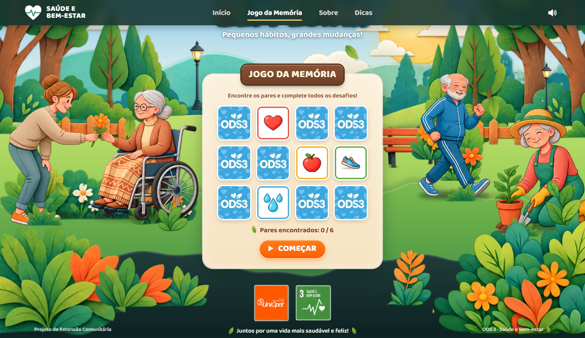

<div align="center">


# Saúde e Bem-Estar · Jogo da Memória

**Pequenos hábitos, grandes mudanças!**
Landing page interativa com jogo da memória, criada para o Projeto de Extensão Comunitária do Centro Universitário UniOpet, alinhada à **ODS 3 – Saúde e Bem-Estar**.

<p>
  
  
  
  
  
</p>
<p>
  
  
  
  
  
</p>



</div>

---

## Sobre o projeto

A **ODS 3** lembra que viver bem é um direito de todas as idades. Esta página convida o visitante a refletir sobre o cuidado com as pessoas idosas por meio de um **jogo da memória lúdico** e de dicas simples de saúde: atenção, carinho e pequenos gestos que trazem saúde, alegria e dignidade a quem sempre cuidou de nós.

## Funcionalidades

- 🎮 **Jogo da memória** com 6 pares de cartas (coração, maçã, tênis, água, sol e flor), animações de virada, efeito de acerto e confete na vitória.
- 🧭 **Barra de navegação fixa** (desktop e mobile): permanece visível ao rolar a página, ganha fundo opaco para manter a leitura e destaca dinamicamente a seção atual.
- 🎨 **Cenário ilustrado em camadas PNG** (parallax leve): sol que se move com a rolagem, nuvens, folhas caindo e vegetação balançando.
- 📱 **Dois layouts sobre a mesma marcação**: pôster vertical para celular/tablet e cena horizontal para telas ≥ 900 px, escalando proporcionalmente com a largura da tela.
- 🔊 **Áudio** com trilha de fundo e efeitos sintetizados via Web Audio API, com botão para ligar/desligar (preferência salva no navegador).
- ♿ **Acessibilidade**: textos alternativos, `aria-live` no placar, foco visível por teclado e suporte a `prefers-reduced-motion`.
- ⚡ **Leve e sem dependências**: HTML, CSS e JavaScript puros, sem frameworks e sem etapa de build.

## Tecnologias

| Tecnologia | Uso |
|---|---|
| **HTML5** | Estrutura semântica e acessível |
| **CSS3** | Layout em camadas com variáveis CSS, container queries (`cqw`), animações e `position: sticky/fixed` |
| **JavaScript (ES6+)** | Lógica do jogo, navegação dinâmica e cenário reativo à rolagem |
| **Web Audio API** | Efeitos sonoros e trilha de reserva sintetizada |
| **Canvas API** | Confete na vitória |
| **Baloo 2** | Tipografia (WOFF2 local, sem requisições externas) |

## Estrutura do projeto

```text
landing-page/
├── index.html            # Marcação da página (cenário, nav, jogo, seções)
├── css/
│   └── styles.css        # Estilos, layouts vertical e horizontal, animações
├── js/
│   ├── game.js           # Jogo da memória
│   ├── audio.js          # Sons e trilha
│   ├── scene.js          # Sol reativo à rolagem
│   └── nav.js            # Barra fixa dinâmica e link ativo
├── assets/
│   ├── img/              # Ilustrações PNG com transparência
│   ├── fonts/            # Baloo 2 (WOFF2)
│   └── audio/            # Trilha de fundo (musica-fundo.mp3)
└── docs/screenshots/     # Imagens usadas neste README
```

## Como executar

Não há dependências nem build. Basta abrir o projeto:

```bash
# 1. Clone o repositório
git clone https://github.com/STATION137/saude-e-bem-estar.git
cd STATION137

# 2. Abra index.html no navegador ou sirva a pasta localmente
python3 -m http.server 8000
# acesse http://localhost:8000
```

## Personalização

| O que alterar | Onde |
|---|---|
| Imagens/cartas do jogo | Lista `PAIRS` em `js/game.js` |
| Trilha de fundo | Substitua `assets/audio/musica-fundo.mp3` (mesmo nome) |
| Posição das camadas do cenário | Variáveis inline `--dx --dy --dw --dz` (desktop) e `--x --y --w --z` (mobile) no `index.html` |
| Altura/aparência da barra superior | `--nav-h` e `.nav` em `css/styles.css` |


